<div align="center">

# Quorum

**An embeddable, strongly-consistent key-value store built on a from-scratch implementation of the Raft consensus algorithm, written in Rust.**


No `openraft`. No `raft-rs`. No consensus library of any kind.

[Overview](#overview) · [Architecture](#architecture) · [Raft Implementation](#raft-implementation) · [Quick Start](#quick-start) · [API](#http-api-reference) · [Demo](#the-demo-killing-the-leader) · [Limitations](#known-limitations)

</div>

---

## Table of Contents

1. [Overview](#overview)
2. [Feature Matrix](#feature-matrix)
3. [Architecture](#architecture)
   - [System view](#system-view)
   - [Workspace layout](#workspace-layout)
   - [Crate dependency graph](#crate-dependency-graph)
   - [Crate-by-crate reference](#crate-by-crate-reference)
4. [Inside a Node](#inside-a-node)
   - [Concurrency model](#concurrency-model)
   - [The event loop](#the-event-loop)
   - [Startup sequence](#startup-sequence)
   - [Write path](#write-path)
   - [Read path](#read-path)
5. [Raft Implementation](#raft-implementation)
   - [Role state machine](#role-state-machine)
   - [Leader election](#leader-election)
   - [Log replication](#log-replication)
   - [The commit rule (§5.4.2)](#the-commit-rule-542)
   - [No-op on election (§8)](#no-op-on-election-8)
   - [Timing parameters](#timing-parameters)
   - [RPC message reference](#rpc-message-reference)
   - [Paper-to-code map](#paper-to-code-map)
6. [Storage and Durability](#storage-and-durability)
7. [Networking and Wire Protocol](#networking-and-wire-protocol)
8. [HTTP API Reference](#http-api-reference)
9. [Configuration](#configuration)
10. [Quick Start](#quick-start)
11. [Rust Client SDK](#rust-client-sdk)
12. [The Demo: Killing the Leader](#the-demo-killing-the-leader)
13. [Chaos Testing CLI](#chaos-testing-cli)
14. [Testing Strategy](#testing-strategy)
15. [A Real Bug This Project Found (and Fixed)](#a-real-bug-this-project-found-and-fixed)
16. [Safety Properties Checklist](#safety-properties-checklist)
17. [Known Limitations](#known-limitations)
18. [Roadmap](#roadmap)
19. [Troubleshooting](#troubleshooting)
20. [Project Stats](#project-stats)
21. [References](#references)
22. [License](#license)

---

## Overview

Quorum is a distributed key-value store. A cluster of N nodes keeps a single, consistent copy of the data. As long as a **majority** of nodes are alive and can talk to each other, the cluster keeps accepting reads and writes. If the leader dies mid-write, the survivors elect a new one and **no acknowledged write is lost**.

Every line of election, replication, and commit logic in [`crates/raft-core`](crates/raft-core) was written directly from the Raft paper ([*In Search of an Understandable Consensus Algorithm*](https://raft.github.io/raft.pdf), Ongaro & Ousterhout). The central claim is backed by an integration test that starts a real 5-node cluster, writes a key, **hard-kills the leader's task with no graceful shutdown**, and asserts that the newly elected leader still serves the write.

### Why this exists

Most "distributed systems" portfolio projects wrap a REST API around an existing consensus crate. That shows you can *use* Raft. This project demonstrates something different: that the algorithm itself, including the safety properties that are easy to get subtly wrong, was implemented, tested, and debugged from first principles.

The target audience is anyone who wants to read a compact (~3k lines), well-commented Raft implementation, or who wants to reason about what happens when a leader dies mid-write, when the network partitions, or when two nodes disagree about who is in charge.

### Highlights

- **Raft from scratch**: leader election, log replication, log-matching consistency check, conflict-index fast backtracking, current-term-only commit rule, and leader no-op on election.
- **Pure core**: `raft-core` performs zero I/O. It contains no sockets, no clocks driving timers, no disk. All of its logic is deterministic functions over plain data types and is unit-tested in isolation.
- **Durable log**: write-ahead log with length-prefixed `bincode` records and an `fsync` on every append; atomic temp-file + rename for truncation and snapshots.
- **Real networking**: length-prefixed `bincode` frames over raw TCP with `TCP_NODELAY`, a 64 MiB frame ceiling, an identity handshake, and automatic reconnect.
- **Observable**: every node serves `/health` and a push-based WebSocket stream (`/ws`) of its live Raft state; structured JSON logs via `tracing`.
- **Smart client SDK**: automatic leader discovery, redirect following, and refusal to trust hints pointing at unknown nodes.
- **Chaos tooling and one-command cluster**: a 5-node `docker-compose` topology and a CLI for killing and partitioning nodes.

---

## Feature Matrix

| Area | Status | Notes |
|---|---|---|
| Leader election (randomized timeouts) | ✅ Implemented | 150–300 ms randomized, §5.2 |
| Up-to-date-log vote restriction | ✅ Implemented | §5.4.1, tested |
| Log replication / `AppendEntries` | ✅ Implemented | Doubles as heartbeat |
| Log-matching check + conflict index | ✅ Implemented | Fast `next_index` backtracking |
| Current-term-only commit rule | ✅ Implemented | §5.4.2, tested |
| Leader no-op on election | ✅ Implemented | §8, found via integration test |
| Write-ahead log with fsync | ✅ Implemented | Leader and follower append paths |
| WAL replay on startup | ✅ Implemented | Log rebuilt from disk |
| Snapshot save/load (atomic) | 🟡 Library only | Not yet triggered by the node |
| Log compaction | 🟡 Building blocks | `truncate_from` + snapshots exist, no scheduler |
| Persisted `current_term` / `voted_for` | ❌ Not yet | See [limitations](#known-limitations) |
| Linearizable reads (ReadIndex / leases) | ❌ Not yet | Reads served from leader's local state |
| Dynamic membership changes | ❌ Not yet | Static peer list from environment |
| `InstallSnapshot` RPC | ❌ Not yet | |
| TLS / authentication | ❌ Not yet | |
| HTTP + WebSocket API | ✅ Implemented | Axum 0.8 |
| Rust client SDK | ✅ Implemented | Leader tracking + redirect |
| Docker Compose 5-node cluster | ✅ Implemented | |
| Chaos CLI | ✅ Implemented | Windows-oriented, 3-node registry |

---

## Architecture

### System view

A Quorum cluster is a full mesh of identical nodes. Every node runs the same binary; roles (Leader / Follower / Candidate) are runtime state, not deployment configuration.

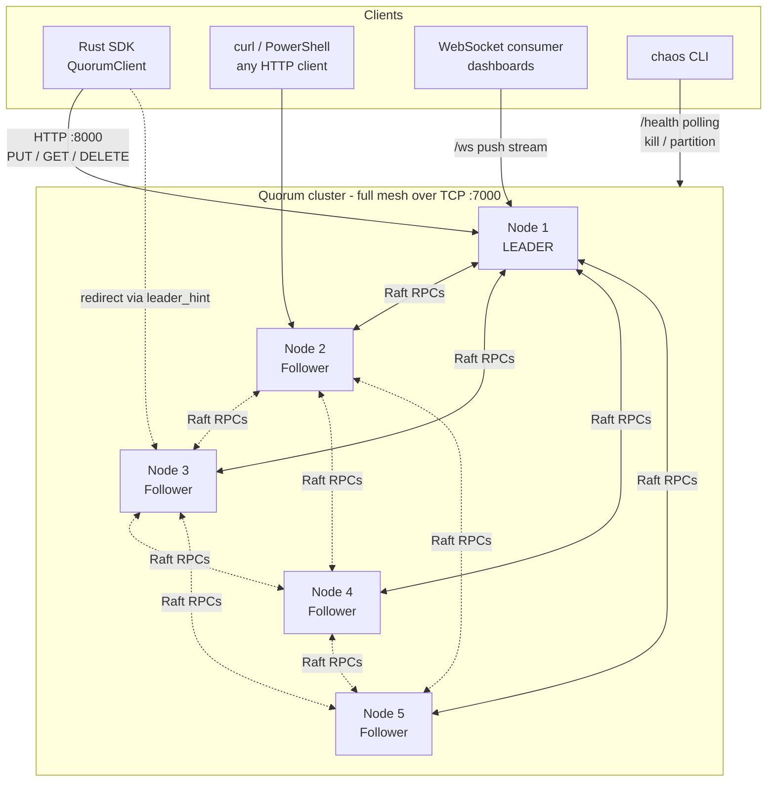

### Workspace layout

```text
quorum/
├── Cargo.toml                  # Workspace root: shared dependency versions
├── Cargo.lock
├── Dockerfile                  # Multi-stage build -> minimal debian runtime image
├── docker-compose.yml          # 5-node cluster on the `quorum-net` bridge network
├── .dockerignore / .gitignore
│
├── crates/
│   ├── raft-core/              # The algorithm. No I/O, no async, no network.
│   │   └── src/
│   │       ├── lib.rs          #   public re-exports
│   │       ├── state.rs        #   Role, PersistentState, VolatileState, LeaderState
│   │       ├── messages.rs     #   RequestVote / AppendEntries / RpcMessage envelope
│   │       ├── log.rs          #   Log + LogEntry (1-indexed, log-matching helpers)
│   │       ├── election.rs     #   timeouts, VoteTally, start_election, handle_request_vote
│   │       └── replication.rs  #   handle_append_entries, commit-index advancement
│   │
│   ├── storage/                # Durability + the state machine
│   │   └── src/
│   │       ├── wal.rs          #   fsync'd write-ahead log, replay, atomic truncate
│   │       ├── snapshot.rs     #   atomic snapshot save/load
│   │       └── kv_store.rs     #   Command {Put, Delete, NoOp} + the KvStore
│   │
│   ├── transport/              # Moves bytes. Knows nothing about Raft logic.
│   │   └── src/
│   │       ├── codec.rs        #   [u32 LE length][bincode] framing, 64 MiB cap
│   │       └── tcp.rs          #   Connection (connect / accept / send / recv)
│   │
│   ├── node/                   # The server binary: wires everything together
│   │   ├── src/
│   │   │   ├── main.rs         #   process bootstrap
│   │   │   ├── config.rs       #   env-var configuration
│   │   │   ├── cluster.rs      #   THE event loop (tokio::select!)
│   │   │   ├── network.rs      #   outbound reconnecting tasks + accept loop
│   │   │   ├── metrics_api.rs  #   Axum HTTP + WebSocket API
│   │   │   └── errors.rs       #   API-level error type
│   │   └── tests/
│   │       └── cluster_integration_test.rs   # real multi-node consensus tests
│   │
│   ├── client/                 # Rust SDK
│   │   └── src/
│   │       ├── lib.rs          #   QuorumClient: get / put / delete
│   │       └── leader_tracking.rs  # leader guess + fallback probing
│   │
│   └── chaos/                  # Failure-injection CLI
│       └── src/{main.rs, commands.rs}
│
└── data/                       # Local-run storage directory (node1/wal.log)
```

### Crate dependency graph

Dependencies point **inward** toward `raft-core`. `raft-core` depends on nothing in the workspace, which is what makes its tests trustworthy.

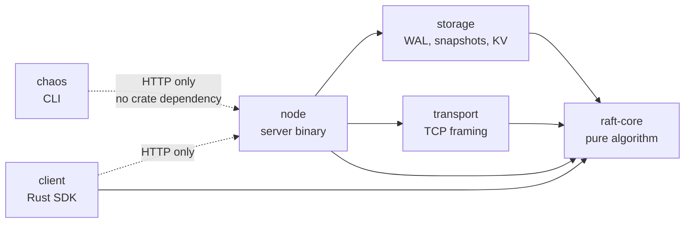

**Design principle.** Every crate boundary is a real separation of concerns, not an arbitrary folder split:

| Crate | Knows about | Deliberately does *not* know about |
|---|---|---|
| `raft-core` | Terms, logs, votes, RPC data types | Sockets, disks, clocks-as-timers, what a "command" means |
| `transport` | Bytes, frames, TCP | Raft semantics (it just moves `RpcMessage` values) |
| `storage` | Durably persisting entries, applying commands | That it is backing a Raft log |
| `node` | How to wire all of the above together | Algorithm internals (it calls into `raft-core`) |

### Crate-by-crate reference

#### `raft-core`: the consensus algorithm

| Item | Purpose |
|---|---|
| `Role` | `Follower`, `Candidate`, `Leader` |
| `PersistentState` | `current_term`, `voted_for`: the state Raft requires to survive a crash |
| `VolatileState` | `role`, `commit_index`, `last_applied`, `last_heartbeat` |
| `LeaderState` | Per-follower `next_index` and `match_index` maps, reset on every election win |
| `Log` / `LogEntry` | 1-indexed log; entries carry `(term, index, command: Vec<u8>)`. Commands are **opaque bytes** at this layer |
| `ElectionTimeoutConfig` | Randomized timeout range (default 150–300 ms) |
| `VoteTally` | Tracks granted votes; `has_majority()` uses a strict `> n/2` rule |
| `start_election` | Increments term, votes for self, becomes Candidate, builds the `RequestVote` |
| `handle_request_vote` | Receiver-side vote logic (stale term, double-vote, log up-to-date check) |
| `handle_append_entries` | Receiver-side replication logic (term check, log matching, truncate+append, commit advance) |
| `build_append_entries` | Builds the per-follower request from its `next_index` |
| `handle_append_entries_response` | Updates `next_index` / `match_index` on success, backs off on conflict |
| `advance_commit_index` | Majority computation, restricted to current-term entries |

#### `storage`: durability and the state machine

| Item | Purpose |
|---|---|
| `Wal` | Append-only file of length-prefixed `bincode` records; `fsync` on every append; `replay`; atomic `truncate_from` |
| `save_snapshot` / `load_snapshot` | Atomic (temp file + `fsync` + rename) snapshot of the whole KV state with `last_included_index/term` metadata |
| `Command` | `Put { key, value }`, `Delete { key }`, `NoOp`: what gets encoded into `LogEntry.command` |
| `KvStore` | A `HashMap<String, Vec<u8>>`; `apply()` is only ever called with committed commands |

#### `transport`: bytes over TCP

| Item | Purpose |
|---|---|
| `write_frame` / `read_frame` | `[4-byte LE length][bincode RpcMessage]`; clean EOF → `Ok(None)`; oversize → `FrameTooLarge` |
| `Connection` | `connect`, `from_stream`, `send`, `recv`; sets `TCP_NODELAY` |
| `bind` | Thin listener helper |

#### `node`: the server

| Module | Purpose |
|---|---|
| `cluster` | `Cluster` owns *all* Raft state and runs the single-threaded event loop |
| `network` | `spawn_outbound` (one reconnecting task per peer) and `run_accept_loop` (handshake + fan-in to the inbox) |
| `metrics_api` | Axum router: `/health`, `/kv/{key}`, `/ws` |
| `config` | `NodeConfig::from_env()` |
| `errors` | `AppError` → HTTP status mapping |

#### `client`: the SDK

`QuorumClient::{new, get, put, delete}` over a `LeaderTracker` that remembers the best leader guess and probes the rest of the cluster in stable ID order on failure.

#### `chaos`: failure injection

`status`, `kill --pid`, `partition --node`, `heal --node`. See [Chaos Testing CLI](#chaos-testing-cli).

---

## Inside a Node

### Concurrency model

All Raft state lives in **one struct (`Cluster`) owned by one task**. Nothing is shared behind locks. Every other task talks to it through channels. This eliminates data races on consensus state by construction, and it makes the event loop easy to reason about: each iteration handles exactly one event to completion.

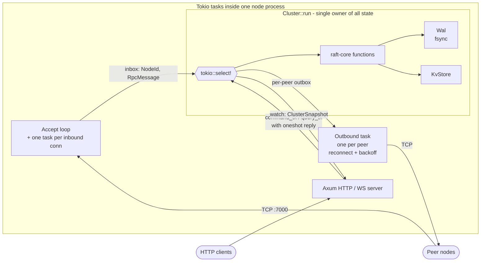

| Channel | Type | Direction | Purpose |
|---|---|---|---|
| `inbox` | `mpsc<(NodeId, RpcMessage)>` | network → cluster | All inbound Raft RPCs, tagged with sender |
| `peer_outboxes[id]` | `mpsc<RpcMessage>` | cluster → network | Outbound messages per peer |
| `command_tx` | `mpsc<ClientCommand>` | HTTP → cluster | Writes; carries a `oneshot` for the reply |
| `query_tx` | `mpsc<ClientQuery>` | HTTP → cluster | Reads; carries a `oneshot` for the reply |
| `snapshot_tx/rx` | `watch<ClusterSnapshot>` | cluster → HTTP/WS | Latest node state, pushed after every loop iteration |

### The event loop

```rust
loop {
    tokio::select! {
        Some((from, msg)) = inbox_rx.recv()      => handle_rpc(from, msg),
        Some(cmd)         = command_rx.recv()    => handle_client_command(cmd),
        Some(query)       = query_rx.recv()      => handle_client_query(query),
        _ = heartbeat_ticker.tick(), if role == Leader     => broadcast_append_entries(),
        _ = election_sleep,          if role != Leader     => begin_election(),
    }
    apply_committed_entries();   // last_applied -> commit_index, resolving pending client writes
    publish_snapshot();          // push state to /health and /ws watchers
}
```

The two timer arms are **mutually exclusive by role guard**: leaders send heartbeats and never time out; everyone else times out and never heartbeats.

### Startup sequence

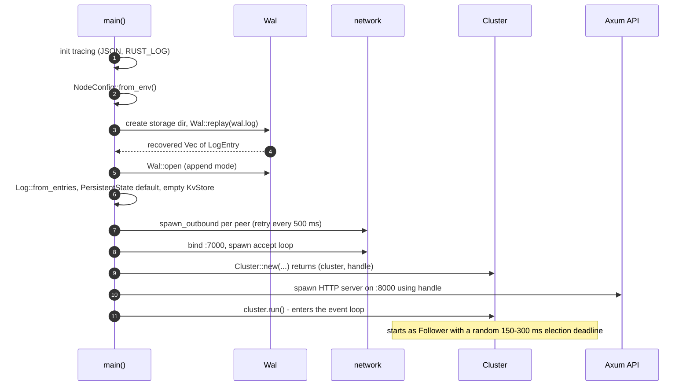

### Write path

A write is acknowledged to the client **only after** it is committed (replicated to a majority) **and applied** to the state machine. The `oneshot` reply channel is stored in `pending_commands` keyed by log index and resolved inside `apply_committed_entries`.

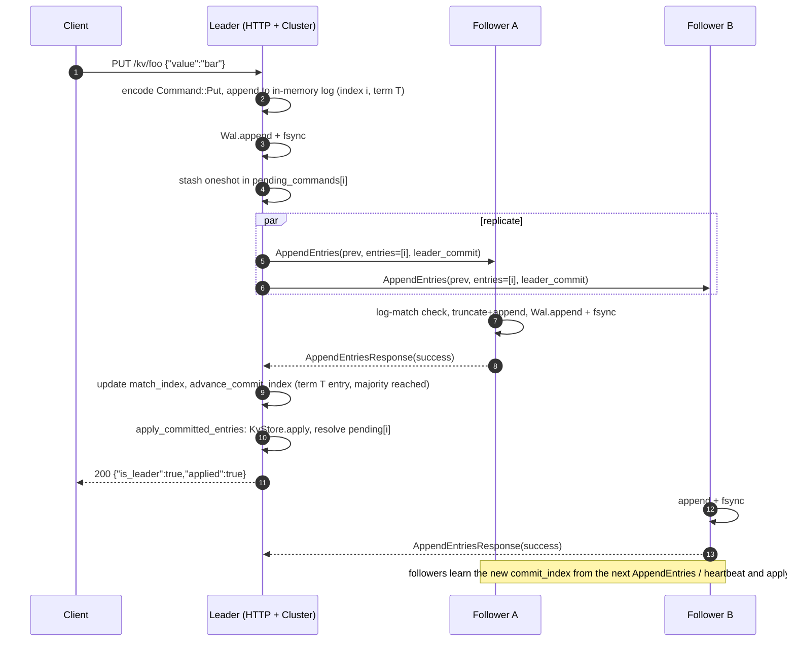

If the request lands on a non-leader, the node replies immediately with `is_leader: false` and a `leader_hint`; nothing is logged.

### Read path

Reads are **not** replicated. The leader answers directly from its locally applied `KvStore`; a follower redirects.

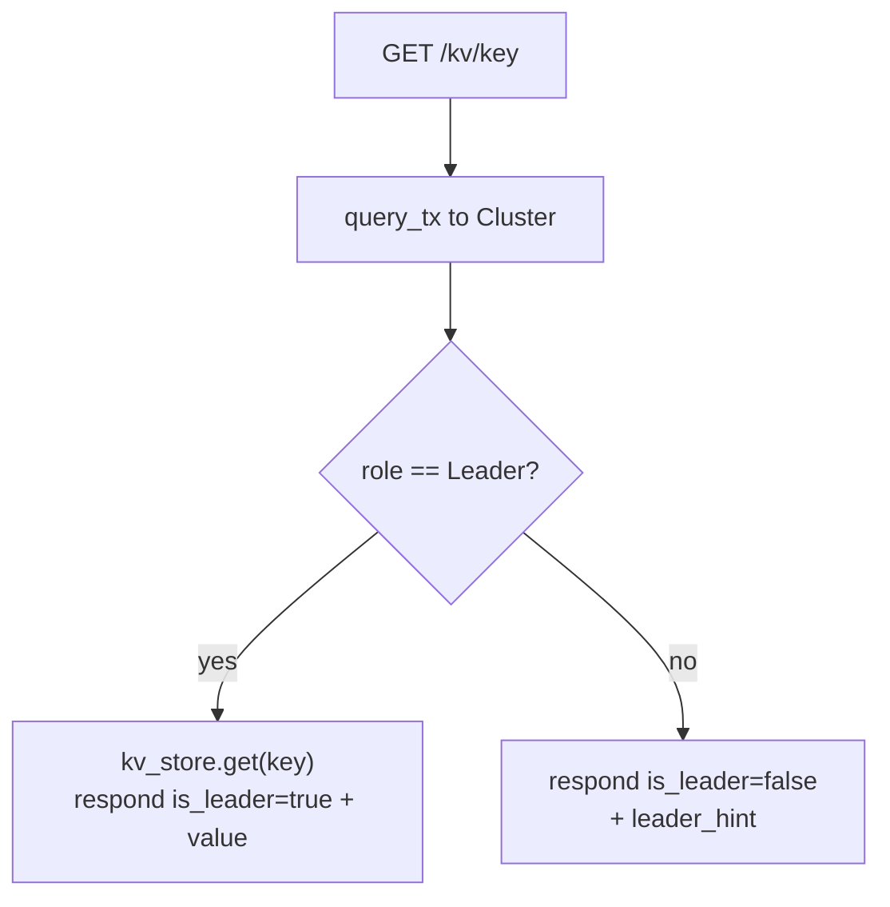

> ⚠️ This is **not strictly linearizable**; see [Known Limitations](#known-limitations).

---

## Raft Implementation

A primer for readers without a distributed-systems background, tied to the code.

### Role state machine

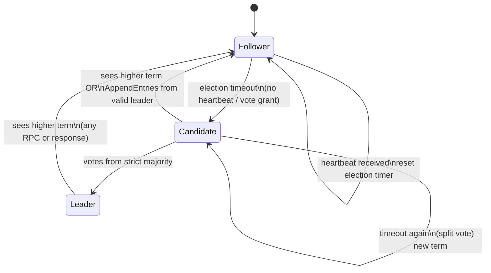

### Leader election

Implemented in [`raft-core/src/election.rs`](crates/raft-core/src/election.rs) and driven by `Cluster::begin_election`.

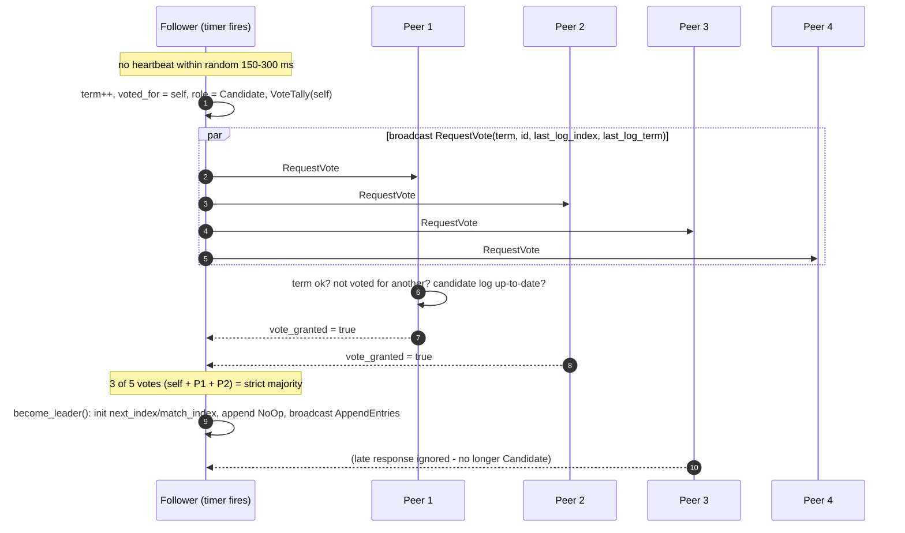

**Vote-granting rules** (`handle_request_vote`) — a vote is granted only if **both** hold:

1. The candidate's term is ≥ ours, and we have not already voted for a *different* candidate this term.
2. The candidate's log is **at least as up-to-date** as ours: compare `(last_log_term, last_log_index)` lexicographically. This is what prevents a node missing committed entries from ever winning and silently discarding history (§5.4.1).

A node seeing a **higher term** in any message immediately adopts it and reverts to Follower.

**Why randomized timeouts?** If all followers timed out at the same instant after a leader died, they would all become Candidates simultaneously, split the vote, and repeat forever. A random timeout in `[150, 300]` ms means one node almost always fires first and wins before the others even start.

**Majority arithmetic**

| Cluster size | Majority needed | Failures tolerated |
|---|---|---|
| 1 | 1 | 0 |
| 3 | 2 | 1 |
| 5 | 3 | 2 |
| 7 | 4 | 3 |

### Log replication

Implemented in [`raft-core/src/replication.rs`](crates/raft-core/src/replication.rs).

- The leader is the only node that accepts writes. It appends locally, then sends `AppendEntries` to each follower, built from that follower's `next_index`.
- The request carries `prev_log_index` / `prev_log_term`. The follower accepts only if its log **contains an entry at that index with that term** (the *log-matching* property, §5.3). Otherwise it rejects.
- **Conflict-index optimization:** on rejection the follower returns a `conflict_index` so the leader jumps `next_index` back in one round trip instead of decrementing one at a time.
- On success, the leader sets `match_index = prev_log_index + entries_sent` and `next_index = match_index + 1`.
- There is **no separate heartbeat RPC**: a heartbeat is just an `AppendEntries` with an empty `entries` list, exactly as in the paper.

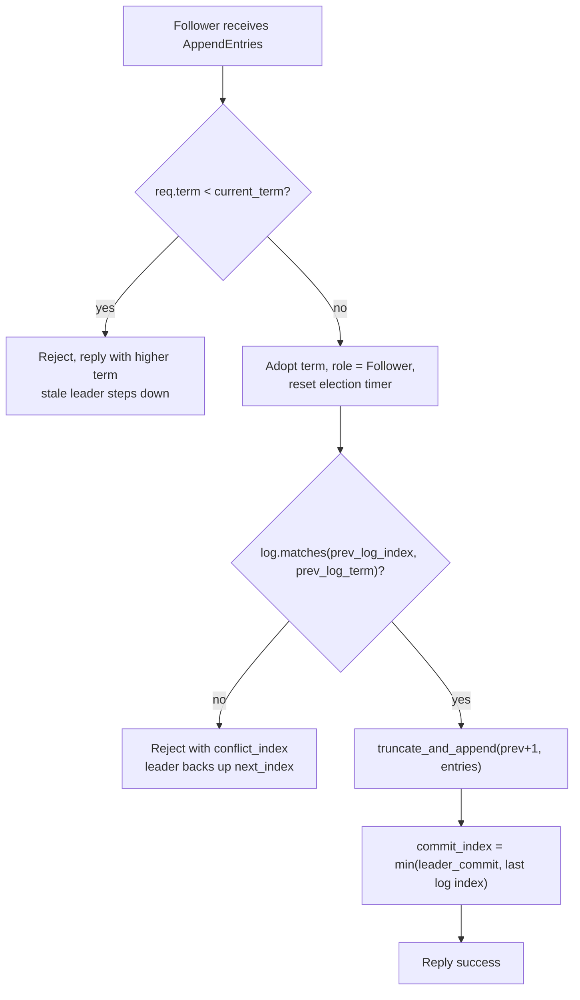

### The commit rule (§5.4.2)

A leader may directly commit **only entries from its own current term**, never an earlier term's entry, even if that entry already sits on a majority. Earlier entries become committed *indirectly* when a current-term entry above them commits (log-matching guarantees everything before a committed entry is identical on every node that has it).

```rust
// raft-core/src/replication.rs  (inside advance_commit_index)
if log.term_at(candidate) != Some(current_term) {
    continue; // never commit an earlier-term entry directly
}
```

Guarded by the dedicated test `commit_index_only_advances_for_current_term_entries`, which fails loudly if the rule is ever violated.

### No-op on election (§8)

The rule above creates a liveness trap. Suppose a leader replicates an entry to a majority and then crashes **before** its next heartbeat can propagate the new commit index. The entry is durable but stranded: followers never learned it was committed, and the new leader may not commit it directly (wrong term).

The fix straight from the paper: **every new leader immediately appends a `NoOp` entry in its own term.** When that no-op commits, everything before it commits too. See `Cluster::become_leader` in [`crates/node/src/cluster.rs`](crates/node/src/cluster.rs).

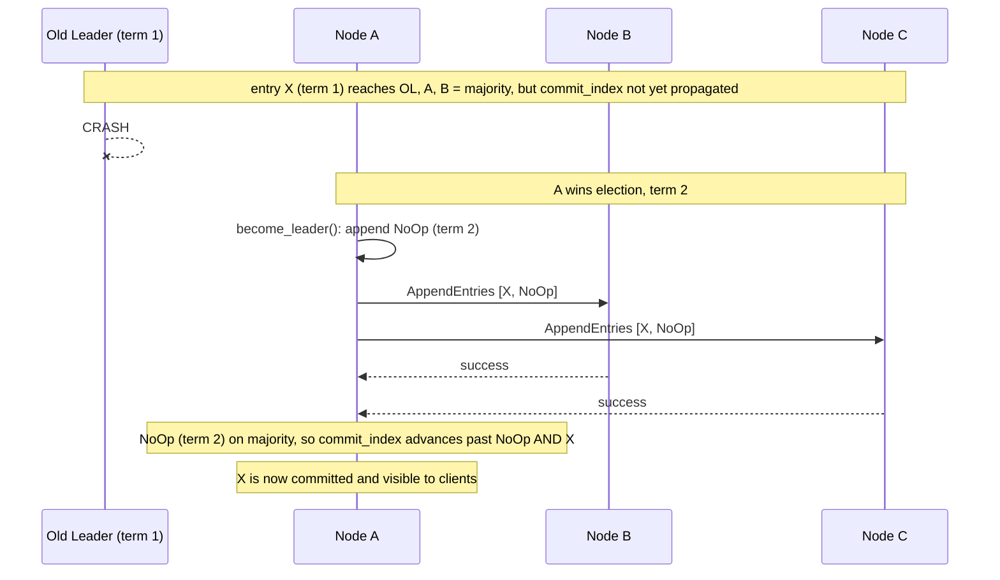

### Timing parameters

| Parameter | Value | Where | Rationale |
|---|---|---|---|
| Election timeout | random 150–300 ms | `ElectionTimeoutConfig::default()` | Paper's reference range; randomization avoids split votes |
| Heartbeat interval | `min_timeout / 4` ≈ **37.5 ms** | `Cluster::heartbeat_interval()` | Must sit well below the minimum election timeout or followers start needless elections |
| Peer reconnect backoff | 500 ms fixed | `network::spawn_outbound` | Nodes race to start; peers may be down |
| Max frame size | 64 MiB | `transport::codec` | Guards against a corrupt length prefix causing unbounded allocation |
| Client HTTP timeout | 5 s | `QuorumClient::new` | Per-request |

### RPC message reference

All inter-node traffic is a single enum, `RpcMessage`:

| Variant | Direction | Fields |
|---|---|---|
| `Hello(NodeId)` | dialer → acceptor, **first frame only** | Sender's node ID (raw TCP carries no identity) |
| `RequestVote` | candidate → all | `term, candidate_id, last_log_index, last_log_term` |
| `RequestVoteResponse` | voter → candidate | `term, vote_granted` |
| `AppendEntries` | leader → follower | `term, leader_id, prev_log_index, prev_log_term, entries[], leader_commit` |
| `AppendEntriesResponse` | follower → leader | `term, success, conflict_index?` |

### Paper-to-code map

| Raft paper | Concept | Code |
|---|---|---|
| §5.1 | Terms, roles, step-down on higher term | `state.rs`, `Cluster::step_down` |
| §5.2 | Randomized election timeouts, vote counting | `election.rs`: `ElectionTimeoutConfig`, `VoteTally`, `start_election` |
| §5.3 | Log replication, log-matching, conflict handling | `replication.rs`, `log.rs::matches / truncate_and_append` |
| §5.4.1 | Election restriction (up-to-date log) | `election.rs::handle_request_vote` |
| §5.4.2 | Commit only current-term entries directly | `replication.rs::advance_commit_index` |
| §7 | Log compaction / snapshots | `storage/snapshot.rs`, `Wal::truncate_from` (not scheduled yet) |
| §8 | Leader no-op on election | `Cluster::become_leader`, `Command::NoOp` |
| §8 | Read-only requests (ReadIndex / leases) | **Not yet implemented** |

---

## Storage and Durability

### What is persisted, and what is not

| State | Persisted? | Notes |
|---|---|---|
| Log entries | ✅ WAL, `fsync` per append | Replayed into `Log` on startup |
| `current_term`, `voted_for` | ❌ | TODO in `main.rs`; see [limitations](#known-limitations) |
| `commit_index`, `last_applied` | ❌ (volatile, per the paper) | Rebuilt as the leader advances commit |
| `KvStore` contents | ❌ | Rebuilt by re-applying committed log entries |
| Snapshot file | 🟡 API exists | Not written or loaded by the node yet |

### WAL record format

```text
 ┌──────────────────┬───────────────────────────────────────────┐
 │ length: u32 (LE) │ bincode( LogEntry { term, index, command } )│   ... repeated
 └──────────────────┴───────────────────────────────────────────┘
   4 bytes            `length` bytes
```

- **Append:** `write_all(len)` → `write_all(payload)` → `sync_all()`. The `fsync` is the point: without it an entry could be "committed" from Raft's view yet live only in the OS page cache.
- **Replay:** read records sequentially until clean EOF. EOF *mid-record* returns `WalError::Truncated` rather than silently accepting a partial write.
- **Truncate (`truncate_from`)**: the WAL is append-only on disk, so truncation = read all → filter → write a temp file → `fsync` → **atomic rename** over the original → reopen in append mode. A crash mid-rewrite leaves either the old file or the new one intact, never a corrupt hybrid.

### Snapshots

```text
 SnapshotFile { metadata: { last_included_index, last_included_term }, state: KvStore }
   └─ bincode-encoded → temp file → fsync → atomic rename → final path
```

The intended recovery flow: load snapshot → replay only WAL entries after `last_included_index`. The primitives are implemented; scheduling and startup integration are on the [roadmap](#roadmap).

---

## Networking and Wire Protocol

### Frame layout

Used identically by the transport (and mirrored by the WAL format):

```text
 ┌──────────────────┬──────────────────────────────┐
 │ length: u32 (LE) │ bincode( RpcMessage )         │
 └──────────────────┴──────────────────────────────┘
   max 64 MiB: larger claimed lengths return FrameTooLarge immediately
```

### Connection topology

Each node **dials every peer** (outbound) and **accepts every peer's dial** (inbound). Between any two nodes there are therefore two TCP connections, one per direction. All messages a node sends to a peer, requests and responses alike, travel over *its own* outbound connection to that peer. Inbound connections are read-only from the acceptor's side.

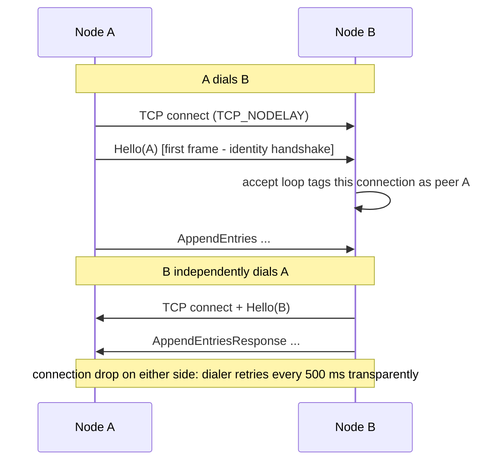

| Behaviour | Detail |
|---|---|
| Identity | First frame must be `Hello(NodeId)`; connections that don't send it are dropped |
| Reconnect | Dialing task loops forever with a fixed 500 ms retry; callers never observe the reconnect |
| Startup races | Peers that aren't up yet are simply retried; nodes can start in any order |
| Fan-in | Every inbound frame is tagged with the sender's `NodeId` and pushed into one shared inbox |
| Latency | `TCP_NODELAY` on both dialed and accepted sockets |

---

## HTTP API Reference

Every node exposes the same API on its **metrics port** (default `8000`; `18001`–`18005` on the host in Docker Compose). Non-leader nodes do **not** return errors for reads/writes. They return `is_leader: false` plus a `leader_hint`, so a client can transparently redirect. Those are normal cluster states, so they come back as `200 OK`, not `4xx`.

| Method | Path | Body | Description |
|---|---|---|---|
| `GET` | `/health` | – | Full `ClusterSnapshot` of this node |
| `GET` | `/kv/{key}` | – | Read a value. Only the leader answers meaningfully |
| `PUT` | `/kv/{key}` | `{"value": "..."}` | Write. Replicated, committed, then applied before the response |
| `DELETE` | `/kv/{key}` | – | Delete. Same commit path as `PUT` |
| `GET` | `/ws` | – | WebSocket: JSON `ClusterSnapshot` pushed on every state change |

### Response schemas

**`GET /health` and each `/ws` message**

```json
{
  "node_id": 3,
  "role": "Leader",
  "current_term": 4,
  "commit_index": 17,
  "last_applied": 17,
  "log_len": 17,
  "leader_hint": 3
}
```

**`GET /kv/{key}`**

```json
{ "is_leader": true,  "value": "quorum-works", "leader_hint": null }   // leader, key exists
{ "is_leader": true,  "value": null,           "leader_hint": null }   // leader, key absent
{ "is_leader": false, "value": null,           "leader_hint": 5    }   // follower: redirect to node 5
```

> Always check `is_leader` **first**. `value: null` alone is ambiguous: it can mean "key doesn't exist" on a real leader or "you hit a follower".

**`PUT` / `DELETE /kv/{key}`**

```json
{ "is_leader": true,  "applied": true,  "leader_hint": null }
{ "is_leader": false, "applied": false, "leader_hint": 5    }
```

### Status codes

| Code | When |
|---|---|
| `200` | Normal responses, including "not the leader" |
| `400` | `AppError::InvalidKey` (reserved) |
| `503` | The node's internal channel is closed (shutting down) |

### Examples

<details open>
<summary><b>curl (Linux / macOS / WSL)</b></summary>

```bash
# who is the leader?
for p in 18001 18002 18003 18004 18005; do curl -s localhost:$p/health; echo; done

# write via the leader (say node 5 on :18005)
curl -s -X PUT localhost:18005/kv/demo \
     -H 'content-type: application/json' -d '{"value":"quorum-works"}'
# {"is_leader":true,"applied":true,"leader_hint":null}

# read it back
curl -s localhost:18005/kv/demo
# {"is_leader":true,"value":"quorum-works","leader_hint":null}

# hit a follower: get a redirect hint instead of an error
curl -s localhost:18001/kv/demo
# {"is_leader":false,"value":null,"leader_hint":5}

# delete
curl -s -X DELETE localhost:18005/kv/demo
```

</details>

<details>
<summary><b>PowerShell (Windows)</b></summary>

```powershell
Invoke-RestMethod http://localhost:18001/health

Invoke-RestMethod -Method Put -Uri "http://localhost:18005/kv/demo" `
  -ContentType "application/json" -Body '{"value":"quorum-works"}'

Invoke-RestMethod http://localhost:18005/kv/demo
Invoke-RestMethod http://localhost:18001/kv/demo   # follower -> is_leader: False, leader_hint: 5
```

</details>

<details>
<summary><b>Live state stream over WebSocket</b></summary>

```bash
# websocat:  cargo install websocat
websocat ws://localhost:18001/ws
```

The stream is **push-based** (a `tokio::sync::watch` channel), not polling: a message is sent whenever the node's snapshot changes, starting with the current state on connect.

</details>

---

## Configuration

Nodes are configured purely through environment variables, so a `docker-compose` `environment:` block is a complete node definition.

| Variable | Required | Default | Description |
|---|---|---|---|
| `QUORUM_NODE_ID` | **yes** | – | Unique, stable `u32` ID. Must not change across restarts |
| `QUORUM_LISTEN_ADDR` | no | `0.0.0.0:7000` | Raft RPC listener (peer-to-peer) |
| `QUORUM_METRICS_ADDR` | no | `0.0.0.0:8000` | HTTP + WebSocket API listener |
| `QUORUM_PEERS` | no | *(empty = single-node)* | Comma-separated `id=host:port` list of **all other** nodes |
| `QUORUM_STORAGE_DIR` | no | `./data` | Directory for `wal.log` (created if missing) |
| `RUST_LOG` | no | `info` | `tracing` env-filter; logs are emitted as JSON |

**Cluster size** is derived as `peers.len() + 1`. Every node must be given a consistent view of the membership. Quorum has no dynamic membership, so all nodes must agree on the peer set.

```text
QUORUM_PEERS="2=node2:7000,3=node3:7000,4=node4:7000,5=node5:7000"
              └┬┘ └───┬───┘
            peer id  host:raft-port
```

---

## Quick Start

### Prerequisites

- **Rust** (stable toolchain, 2021 edition or newer)
- **Docker + Docker Compose**, only for the 5-node demo (not needed to run tests)

### Run the full test suite

```bash
cargo test --workspace
```

Expect **30 tests**: 12 `raft-core`, 4 `transport`, 5 `client`, 5 unit + 2 integration in `node`, 2 `storage`.

### Run a single node

A single-node cluster elects itself instantly (a majority of one).

<details open>
<summary><b>bash</b></summary>

```bash
QUORUM_NODE_ID=1 \
QUORUM_LISTEN_ADDR=127.0.0.1:7000 \
QUORUM_METRICS_ADDR=127.0.0.1:8000 \
QUORUM_STORAGE_DIR=./data/node1 \
cargo run -p node
```

```bash
curl -X PUT localhost:8000/kv/foo -H 'content-type: application/json' -d '{"value":"bar"}'
curl localhost:8000/kv/foo
```

</details>

<details>
<summary><b>PowerShell</b></summary>

```powershell
$env:QUORUM_NODE_ID = "1"
$env:QUORUM_LISTEN_ADDR = "127.0.0.1:7000"
$env:QUORUM_METRICS_ADDR = "127.0.0.1:8000"
$env:QUORUM_STORAGE_DIR = "./data/node1"
cargo run -p node
```

```powershell
Invoke-RestMethod -Method Put -Uri "http://localhost:8000/kv/foo" -ContentType "application/json" -Body '{"value":"bar"}'
Invoke-RestMethod -Uri "http://localhost:8000/kv/foo"
```

</details>

### Run a 3-node cluster locally (no Docker)

This port layout matches what the [chaos CLI](#chaos-testing-cli) expects (metrics `8001–8003`, Raft `7001–7003`). Run each in its own terminal:

```bash
# node 1
QUORUM_NODE_ID=1 QUORUM_LISTEN_ADDR=127.0.0.1:7001 QUORUM_METRICS_ADDR=127.0.0.1:8001 \
QUORUM_PEERS="2=127.0.0.1:7002,3=127.0.0.1:7003" QUORUM_STORAGE_DIR=./data/node1 cargo run -p node

# node 2
QUORUM_NODE_ID=2 QUORUM_LISTEN_ADDR=127.0.0.1:7002 QUORUM_METRICS_ADDR=127.0.0.1:8002 \
QUORUM_PEERS="1=127.0.0.1:7001,3=127.0.0.1:7003" QUORUM_STORAGE_DIR=./data/node2 cargo run -p node

# node 3
QUORUM_NODE_ID=3 QUORUM_LISTEN_ADDR=127.0.0.1:7003 QUORUM_METRICS_ADDR=127.0.0.1:8003 \
QUORUM_PEERS="1=127.0.0.1:7001,2=127.0.0.1:7002" QUORUM_STORAGE_DIR=./data/node3 cargo run -p node
```

### Run the 5-node Docker Compose cluster

```bash
docker compose build
docker compose up -d
docker compose ps
```

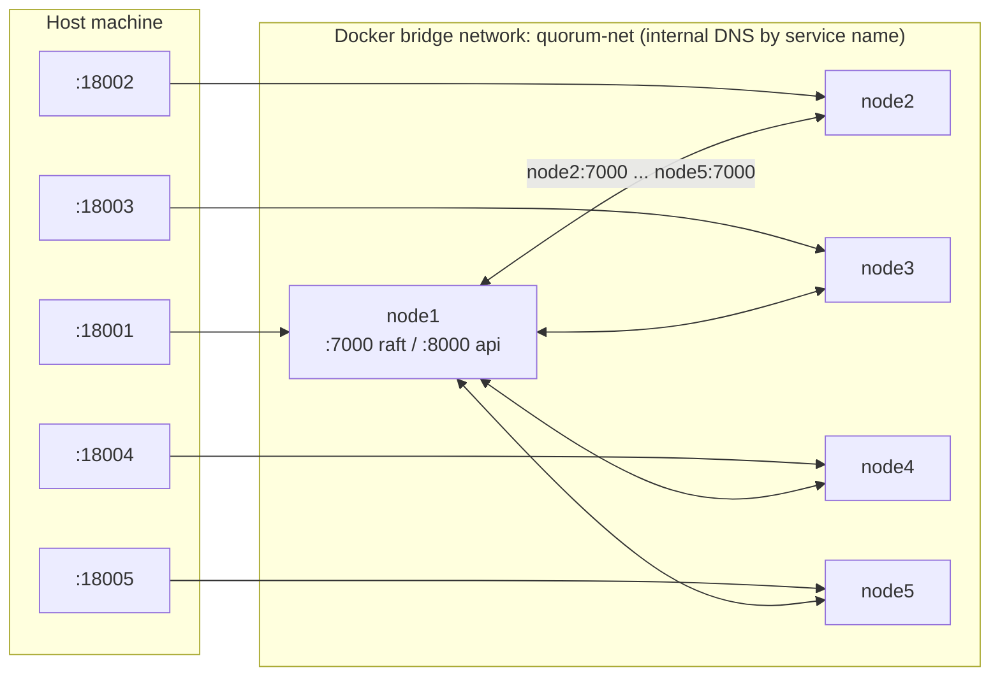

| Service | Container | Host API port | Peers (internal) |
|---|---|---|---|
| `node1` | `quorum-node1` | `18001` | `node2..node5:7000` |
| `node2` | `quorum-node2` | `18002` | `node1,3,4,5:7000` |
| `node3` | `quorum-node3` | `18003` | `node1,2,4,5:7000` |
| `node4` | `quorum-node4` | `18004` | `node1,2,3,5:7000` |
| `node5` | `quorum-node5` | `18005` | `node1,2,3,4:7000` |

Notes on the container setup:

- **Multi-stage `Dockerfile`**: compiles `node` in `rust:1-slim-bookworm`, ships only the binary on `debian:bookworm-slim`.
- **Raft port `7000` is internal only.** Only the HTTP API (`8000`) is published to the host.
- **`restart: "no"`** is deliberate: a killed node must *stay down* so you can watch the survivors elect a new leader instead of it silently coming back.
- The compose file does not mount a volume for `/data`, so each container's WAL is ephemeral and lives only as long as the container does.

Find the leader (exactly one node reports `"role":"Leader"`):

```bash
for p in 18001 18002 18003 18004 18005; do curl -s localhost:$p/health | jq -c '{node_id,role,current_term,leader_hint}'; done
```

---

## Rust Client SDK

`QuorumClient` hides leader discovery. You give it the HTTP address of each node; it figures out who the leader is and retries transparently.

```rust
use client::QuorumClient;
use std::collections::HashMap;

#[tokio::main]
async fn main() -> Result<(), Box<dyn std::error::Error>> {
    let nodes = HashMap::from([
        (1, "127.0.0.1:18001".to_string()),
        (2, "127.0.0.1:18002".to_string()),
        (3, "127.0.0.1:18003".to_string()),
        (4, "127.0.0.1:18004".to_string()),
        (5, "127.0.0.1:18005".to_string()),
    ]);

    let db = QuorumClient::new(nodes);

    db.put("greeting", "hello").await?;
    assert_eq!(db.get("greeting").await?, Some("hello".to_string()));
    db.delete("greeting").await?;
    Ok(())
}
```

### How leader discovery works

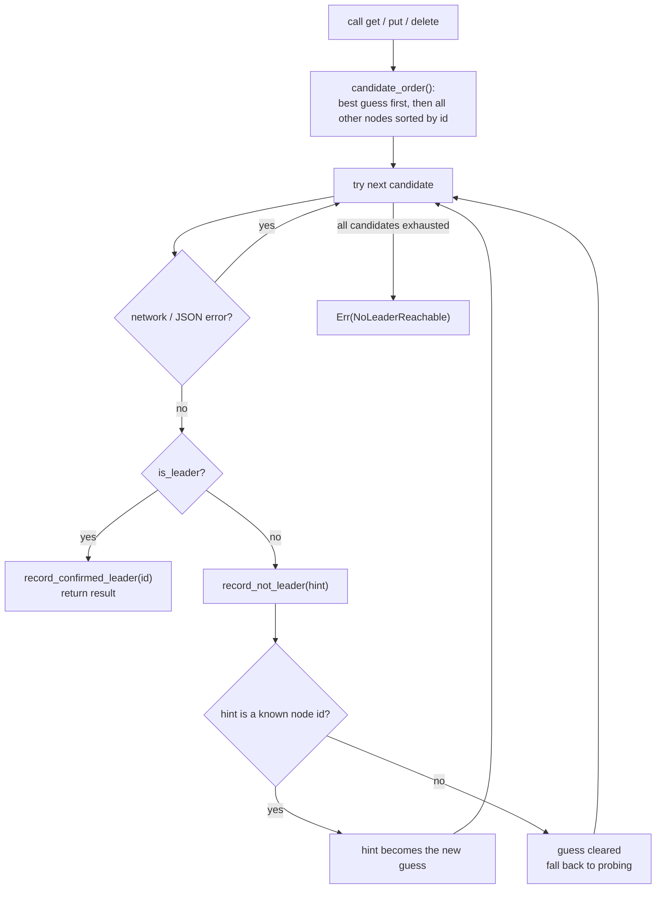

| Behaviour | Detail |
|---|---|
| Sticky leader | The last confirmed leader is tried first on every subsequent call |
| Untrusted hints | A `leader_hint` naming a node ID not in the client's node map is **ignored** (guess cleared) rather than followed |
| Stable probing order | Fallback candidates are sorted by node ID for deterministic behaviour |
| Failure | After every node has been tried once: `ClientError::NoLeaderReachable` |
| Timeout | 5 s per HTTP request |

---

## The Demo: Killing the Leader

The whole point of the project is watching a cluster survive a real crash.

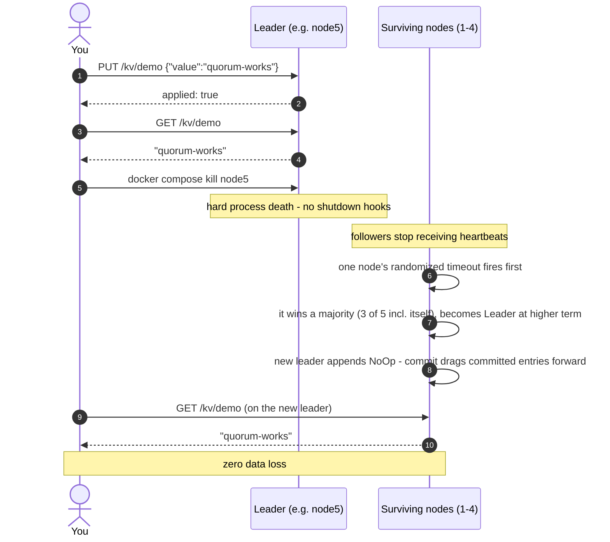

**1. Find the leader** (poll `/health` until `role: Leader`).

**2. Write a value through it** and confirm it reads back.

**3. Kill it outright:**

```bash
docker compose kill node5      # use the actual leader's service name
```

**4. Watch a new leader emerge**: poll the remaining nodes (or subscribe to `/ws`). Within a few hundred milliseconds one node flips to `Leader` at a higher `current_term`.

**5. Confirm zero data loss**: read your key from the new leader. It is still there.

### Simulating a network partition instead of a crash

The container keeps running but cannot talk to the rest of the cluster:

```bash
docker network disconnect quorum-net node3
# ... the other four carry on; node3 can't hear heartbeats ...
docker network connect quorum-net node3
# ... node3 reconnects and catches up through normal AppendEntries replication ...
```

---

## Chaos Testing CLI

For nodes started directly with `cargo run` (not Docker), [`crates/chaos`](crates/chaos) provides failure injection **without the node binary knowing chaos testing exists**:

```powershell
cargo run -p chaos -- status                  # role / term / commit_index / last_applied / log_len per node
cargo run -p chaos -- kill --pid <PID>        # taskkill /F: real process death
cargo run -p chaos -- partition --node 2      # Windows Firewall rule blocking node 2's Raft port (Administrator)
cargo run -p chaos -- heal --node 2           # remove that rule
```

| Command | Mechanism | Requirements |
|---|---|---|
| `status` | `GET /health` against each node in the registry (2 s timeout) | Nodes reachable on `127.0.0.1` |
| `kill --pid` | `taskkill /F /PID` | Windows; you supply the PID |
| `partition --node N` | `netsh advfirewall ... action=block dir=in localport=<raft_port>` (rule name `quorum-partition-nodeN`) | Windows, **elevated** terminal |
| `heal --node N` | `netsh advfirewall firewall delete rule name=quorum-partition-nodeN` | Windows, elevated terminal |

**Scope notes (deliberate boundaries):**

- The node registry is **hard-coded to a 3-node local topology**: metrics ports `8001–8003`, Raft ports `7001–7003`. That matches the [3-node local layout](#run-a-3-node-cluster-locally-no-docker) above.
- `partition`/`heal` toggle a **host-level** firewall rule. They do **not** affect Docker containers (inter-container traffic never touches the host firewall). For Docker, use `docker compose kill` and `docker network disconnect/connect`.
- The firewall rule blocks only **inbound** traffic on the target node's Raft port.

---

## Testing Strategy

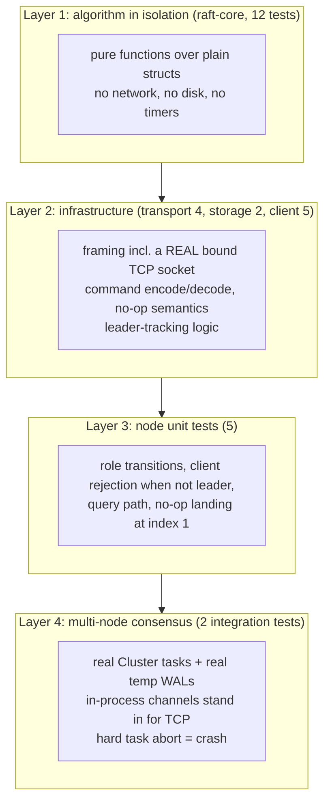

### Test inventory (30)

| Crate | Count | Highlights |
|---|---|---|
| `raft-core` | 12 | `grants_vote_for_higher_term_with_up_to_date_log`, `rejects_vote_for_stale_term`, `rejects_second_vote_in_same_term`, **`rejects_vote_when_candidate_log_is_behind`**, `vote_tally_reaches_majority_at_correct_threshold`, `accepts_heartbeat_on_empty_log`, `rejects_stale_leader_term`, `rejects_and_reports_conflict_on_log_mismatch`, `truncates_conflicting_entries_and_appends_new_ones`, **`commit_index_only_advances_for_current_term_entries`**, `replication_response_advances_next_and_match_index_on_success`, `replication_response_retreats_next_index_on_conflict` |
| `transport` | 4 | Codec round-trip, clean-EOF → `None`, oversize-frame rejection, and a **round-trip over a real TCP socket** |
| `client` | 5 | Starts with no guess; records confirmed leader; recognized hint becomes guess; **unrecognized hint is not trusted**; fallback order excludes the tried node |
| `storage` | 2 | `NoOp` encode/decode round-trip; applying `NoOp` changes nothing |
| `node` (unit) | 5 | Single node elects itself; commands/queries rejected when not leader; leader appends command at index 2 (no-op is index 1); leader answers read from applied state |
| `node` (integration) | 2 | **`three_node_cluster_elects_exactly_one_leader`**, **`cluster_survives_leader_crash_with_zero_data_loss`** |

### The integration tests

`crates/node/tests/cluster_integration_test.rs` builds full N-node clusters where every node is a real `Cluster::run()` task with a real temp-file WAL, linked to every other node by in-process channels. Nothing in `raft-core` or `storage` is mocked. (Byte framing is already covered by the transport tests; these prove *consensus* behaviour.)

`cluster_survives_leader_crash_with_zero_data_loss`:

1. Spin up a **5-node** cluster; wait for a leader.
2. `PUT critical-key = must-survive` on the leader; assert `Applied`.
3. **`JoinHandle::abort()`** the leader's task, with no graceful shutdown and no final heartbeat.
4. Wait for a **different** node to become leader.
5. Read `critical-key` from the new leader and assert the value is intact.

```bash
cargo test --workspace                                       # everything
cargo test -p raft-core                                      # algorithm only
cargo test -p node --test cluster_integration_test           # the crash-survival tests
cargo test -p node --test cluster_integration_test -- --nocapture
```

---

## A Real Bug This Project Found (and Fixed)

While writing the leader-crash integration test, it **failed**, not because the test was wrong, but because it exposed a genuine gap:

> A leader that dies right after replicating an entry to a majority (but before its next heartbeat) leaves that entry durable but **stuck**: survivors don't know it is committed, and a new leader can't commit it directly because of the very "current-term-only" rule this project already enforced and tested.

**Diagnosis:** the safety rule (§5.4.2) was correct; what was missing was its companion from §8.

**Fix:** every new leader immediately appends a `NoOp` entry in its own term (`become_leader`). Once that commits, log-matching commits the stranded entry with it. A dedicated `Command::NoOp` variant (a state-machine no-op, tested to change nothing) was added, and the unit test `leader_appends_client_command_to_log` now expects client writes at index 2 because index 1 is the no-op.

This is documented deliberately rather than hidden: finding a subtle bug through an automated correctness test, diagnosing it against the paper, and fixing it properly demonstrates understanding better than never having had a bug at all.

---

## Safety Properties Checklist

| Raft property | Enforced by | Evidence |
|---|---|---|
| **Election safety**: at most one leader per term | One vote per term (`voted_for`), strict-majority `VoteTally` | `rejects_second_vote_in_same_term`, `vote_tally_reaches_majority_at_correct_threshold`, `three_node_cluster_elects_exactly_one_leader` |
| **Leader completeness**: a leader has all committed entries | Up-to-date-log vote restriction | `rejects_vote_when_candidate_log_is_behind` |
| **Log matching**: same `(index, term)` ⇒ identical prefix | `prev_log_index/term` consistency check | `rejects_and_reports_conflict_on_log_mismatch`, `truncates_conflicting_entries_and_appends_new_ones` |
| **Leader append-only**: leaders never overwrite their own log | Leader only calls `Log::append` | Code structure |
| **State-machine safety**: all nodes apply the same commands in order | Apply only up to `commit_index`, in index order | `apply_committed_entries` + integration test |
| **Current-term-only direct commit** | `advance_commit_index` guard | `commit_index_only_advances_for_current_term_entries` |
| **No stranded commits after leader change** | No-op on election | `cluster_survives_leader_crash_with_zero_data_loss` |
| **Stale leaders step down** | Higher term in any RPC/response ⇒ `Follower` | `rejects_stale_leader_term`, `step_down` |
| **Durability before ack** | `fsync` on every WAL append before replying / counting | `Wal::append` |

---

## Known Limitations

Documented up front, with the *reason* for each. This list reflects a close reading of the current code.

### Consistency and safety

- **Reads are not strictly linearizable.** `GET` is answered from the leader's local applied state without the ReadIndex / lease protocol of §8. A deposed leader that hasn't yet learned it lost an election could serve a stale value.
- **`current_term` / `voted_for` are not persisted** (`// TODO` in `main.rs`). A restarted node comes back at term 0 with no vote recorded. Raft requires these to survive crashes: without them a restarted node could vote a second time within a term it had already voted in, which can in principle allow two leaders in one term. In practice it will usually just lose to higher-term nodes, but the guarantee is not airtight until this is persisted.
- **`AppendEntriesResponse` isn't correlated to the request it answers.** The leader reconstructs "what was sent" from the follower's *current* `next_index` and its *current* log tail. If a client write lands while an earlier `AppendEntries` is still in flight, `match_index` can be over-estimated (counting an entry the follower had not yet acknowledged). The standard fix is to echo `prev_log_index + len(entries)` in the response, or track in-flight requests.
- **Follower truncation is unconditional.** `handle_append_entries` truncates and appends whenever `entries` is non-empty. The paper (§5.3) says to truncate only on an actual *conflict*, so that a delayed or duplicated `AppendEntries` can't delete matching entries that were already appended.
- **Static membership.** The peer set is fixed at startup; there is no joint-consensus / single-server membership change.

### Durability and storage

- **The WAL is not reconciled with in-memory truncation.** `Wal::truncate_from` exists and is atomic, but the node does not call it when a follower discards conflicting entries, and followers append every received entry to the WAL. After restart, replay could therefore contain conflicting or duplicate records.
- **No log compaction is running.** Snapshots can be saved/loaded and the WAL can be truncated, but nothing triggers them and nothing loads a snapshot at startup, so the WAL grows without bound.
- **State machine is rebuilt from the log.** `KvStore` is not persisted; after a restart it is repopulated by re-applying committed entries once the node learns the commit index.
- **One `fsync` per entry.** Simple and correct, but not batched, so write throughput is bounded by disk sync latency.
- **Compose has no volumes.** Container WALs die with the container.

### Operational

- **No timeout on pending writes.** If a leader loses leadership before its entry commits, the HTTP request's `oneshot` is never resolved and the client waits (the SDK's 5 s timeout then fires). Pending entries are not failed on step-down.
- **Unbounded in-memory channels** between tasks: no backpressure under overload.
- **No TLS or auth** on either the Raft port or the HTTP API. Run on a trusted network only.
- **Values are exposed as UTF-8 strings** over HTTP (`from_utf8_lossy`); non-UTF-8 bytes stored via other means would be altered on read. Keys are interpolated into URLs by the SDK without percent-encoding.
- **No `InstallSnapshot`:** a follower that falls behind a compacted prefix couldn't be caught up (moot until compaction is wired in).
- **Chaos CLI is Windows- and 3-node-oriented** (see [above](#chaos-testing-cli)).

---

## Roadmap

Roughly in order of correctness impact:

- [ ] Persist `current_term` and `voted_for` (fsync before replying to any RPC)
- [ ] Echo the replicated index in `AppendEntriesResponse`; fix match-index accounting
- [ ] Truncate only on conflict; mirror truncation into the WAL
- [ ] Linearizable reads via ReadIndex (or leader leases)
- [ ] Fail pending client requests when a leader steps down; add per-request deadlines
- [ ] Snapshot scheduling, startup load, and `InstallSnapshot`
- [ ] Pre-vote and leader check-quorum to reduce disruption from partitioned nodes
- [ ] Membership changes (single-server or joint consensus)
- [ ] Bounded channels / backpressure; WAL group-commit batching
- [ ] TLS + authentication
- [ ] Deterministic simulation / Jepsen-style linearizability checking
- [ ] Prometheus metrics endpoint and a web dashboard on top of `/ws`

---

## Troubleshooting

| Symptom | Likely cause | Fix |
|---|---|---|
| No node ever reports `Leader` | Fewer than a majority of nodes up or reachable | Check `docker compose ps`; check `peer unreachable` debug logs (`RUST_LOG=debug`) |
| Every node shows `Follower`, terms keep climbing | Peers can't reach each other (wrong `QUORUM_PEERS` host/port) | Verify peer addresses use the **Raft** port (7000), not the API port |
| `is_leader: false` with `leader_hint: null` | Election in progress or this node hasn't heard from a leader yet | Retry after a few hundred ms; the SDK does this automatically |
| `PUT` seems to hang | Leader lost leadership before commit (see limitations) or no majority | Use the SDK's timeout/retry; check cluster health |
| `chaos partition` has no effect | Not an elevated terminal, or nodes are in Docker | Run as Administrator; for Docker use `docker network disconnect` |
| `chaos status` shows `UNREACHABLE` | Nodes aren't on ports `8001–8003` | Match the 3-node local layout |
| Restarted node briefly disrupts the cluster | Term isn't persisted (starts at 0) | Known; see limitations |
| Port already in use (`18001`…) | Another process owns the port | Change the host side of `ports:` in `docker-compose.yml` |

---

## Project Stats

| | |
|---|---|
| Workspace crates | **6** (`raft-core`, `storage`, `transport`, `node`, `client`, `chaos`) |
| Tests | **30** (12 raft-core, 4 transport, 5 client, 5 node-unit, 2 node-integration, 2 storage) |
| Consensus | Implemented from the paper, no consensus library |
| Runtime | Tokio async, single-owner event loop per node |
| API | Axum 0.8: REST + WebSocket |
| Serialization | `bincode` (wire + disk), `serde_json` (HTTP) |
| Notable documented bug | 1 (found via automated test, fixed per paper §8) |

---

## References

- Diego Ongaro and John Ousterhout. [*In Search of an Understandable Consensus Algorithm*](https://raft.github.io/raft.pdf) (USENIX ATC 2014): the extended version is the primary reference for this implementation.
- Diego Ongaro. [*Consensus: Bridging Theory and Practice*](https://github.com/ongardie/dissertation) (PhD dissertation), covering membership changes, log compaction, and client interaction (linearizable reads).
- [raft.github.io](https://raft.github.io/): visualizations and the Raft mailing list.

---

## License

MIT

Repository: [github.com/MuaazTasawar/quorum](https://github.com/MuaazTasawar/quorum)
